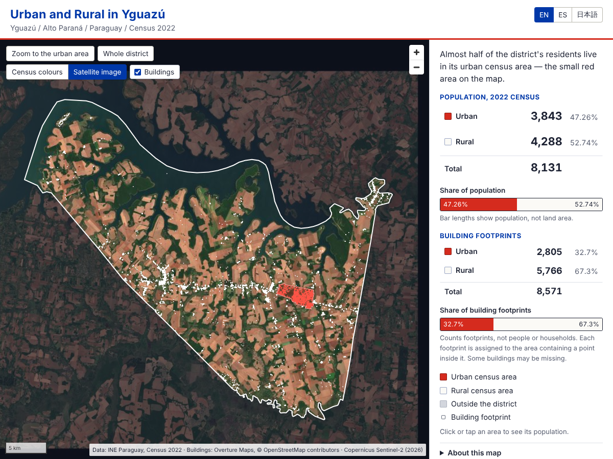

# Urban and Rural in Yguazú / Yguazúの都市と農村

30DayMapChallenge 2026 Day 9「Urban-rural」の作品。パラグアイ Alto Paraná 県 Yguazú 地区（地区コード1009）を、2022年国勢調査の都市・農村区分で2色に塗り分け、それぞれの人口を示す。地区人口8,131人のうち47.26%（3,843人）が、地図上では小さな都市区域に暮らしている。

統計上の線引きを別の視点と比べるため、Overture Maps の建物の輪郭（8,571棟）と Sentinel-2 の衛星写真（2026年9月26日）を重ねられる。建物の32.7%が都市区域にあり、残りは農村区域の幹線道路沿いや都市区域のすぐ外側に集まっている。

- 公開URL：https://shinyanakashima.github.io/30daymapchallenge-2026day9-campo-ciudad/
- 表示言語：英語（初期表示）・スペイン語・日本語。画面右上の EN / ES / 日本語 で切り替える。`?lang=es`・`?lang=ja` でも指定できる。スペイン語では数値を 8.131、47,26 % と表記する。



*Urban and rural census areas of Yguazú, Alto Paraná, Paraguay, with their 2022 populations. Almost half of the district's 8,131 residents live in the small urban area. Building footprints from Overture Maps and a Sentinel-2 satellite image can be overlaid. English is the default; Spanish and Japanese are available from the header (or `?lang=es` / `?lang=ja`).*

## 表示しているもの

| 区分 | INE area code | 人口（2022年） | 人口割合 |
| --- | --- | ---: | ---: |
| Urban / 都市 | 1 | 3,843 | 47.26% |
| Rural / 農村 | 6 | 4,288 | 52.74% |
| Total / 合計 | — | 8,131 | 100% |

| 建物 | 棟数 | 割合 |
| --- | ---: | ---: |
| 都市区域 | 2,805 | 32.7% |
| 農村区域 | 5,766 | 67.3% |
| 合計 | 8,571 | 100% |

人口割合は画面の横棒で示し、「面積の割合ではない」と明記している。建物数の横棒も別に置き、「人数や世帯数ではない」と明記している。境界から計算できる参考面積（都市約7.59 km²、農村約787.41 km²）は公表統計値ではないため、画面には出していない。

## 出典

- Instituto Nacional de Estadística（INE）, Paraguay. [Cartografía digital 2022](https://www.ine.gov.py/microdatos/cartografia-digital-2022.php)：Alto Paraná の GeoJSON（RAR、11,885,739 bytes、SHA-256 `a9ff06b8…5527158`）。`Barrios Localidades_Alto Parana.geojson` と `Distritos_Alto Parana.geojson` を使用。
- INE. [Censo 2022 – Estructura de la población por edad y sexo](https://www.ine.gov.py/Publicaciones/Biblioteca/documento/257/Censo%202022%20-%20Estructura%20de%20la%20poblacion%20por%20edad%20y%20sexo.pdf)：Cuadro A1・A13 の Yguazú 都市・農村人口。PDFの値を確認して入力した（自動取得したCSVではない）。
- AREAコードの意味（`1=URBANA`、`6=RURAL`）は、INEのRARに説明表が同梱されていないため、パラグアイ保健省ドメインの[公式コード表](https://vigicanpy.mspbs.gov.py/guia/site/CodeSystem-GeoTipoAreasPYCS.html)で補った。
- 建物：[Overture Maps Foundation](https://docs.overturemaps.org/attribution/) リリース 2026-10-21.0 の buildings テーマ（ODbL）。OpenStreetMap（© OpenStreetMap contributors、ODbL）、Google Open Buildings（CC BY 4.0）、Microsoft ML Building Footprints（ODbL）を含む。
- 衛星写真：Copernicus Sentinel-2 L2A の真色画像（TCI、10 m）。2026年9月26日撮影の4タイル（雲量0%）。[Element 84 Earth Search](https://earth-search.aws.element84.com/v1) から取得。「Contains modified Copernicus Sentinel data 2026」。
- 取得・加工：国勢調査データは2026年11月6日、建物と衛星写真は2026年11月9日。

### ライセンス

元データは[パラグアイ公共情報利用ライセンス](https://www.ine.gov.py/microdatos/license.php)に従って利用し、出典・加工内容・取得時点を README と画面に記している。本作品はINEの公式成果物・後援作品ではない。

建物データ `public/data/day9-yguazu-buildings.parquet` は Overture Maps の派生データで、ODbL に従う（含まれる Google Open Buildings は CC BY 4.0）。衛星タイル `public/tiles/` は [Copernicus Sentinel データの利用条件](https://sentinels.copernicus.eu/documents/247904/690755/Sentinel_Data_Legal_Notice)に従い、出典を表示している。

リポジトリの `LICENSE`（MIT）はアプリのコードにのみ適用する。`public/data/` と `public/tiles/` のデータ、およびそれらの元データには適用しない。

## 加工

1. RARを展開し、`Barrios Localidades_Alto Parana.geojson` を `CLAVE = '1009'` で絞り込む（28区域：都市6・農村22）。元データのCRSは EPSG:4674（SIRGAS 2000）。
2. AREA別に union して都市1面・農村1面にし、EPSG:4326（WGS 84）へ変換する。簡略化はしていない。
3. 統合面が地区境界を隙間・はみ出しなく覆うこと、都市・農村の重複面積が0であること、全ポリゴンが valid であることを確認した。
4. 人口は統合後の2行にだけ付与し、GeoParquet 1.1.0（geometry は WKB、ZSTD圧縮、29,655 bytes）として書き出す。

処理スクリプトは `scripts/prepare-yguazu.py`、検査値と元ファイルのハッシュは `scripts/day9-verification.json`。いずれもポータルリポジトリ [shinyanakashima/30daymapchallenge](https://github.com/shinyanakashima/30daymapchallenge) の `docs/research/` から引き継いだもの。

```bash
python -m pip install shapely pyproj pyarrow
python scripts/prepare-yguazu.py /path/to/extracted-directory
```

`Ciudades_Alto Parana.geojson` は点データなので、都市の範囲には使っていない。

### 建物

1. `scripts/fetch-overture-buildings.py`：DuckDB で Overture の S3（匿名）から、地区の外接矩形に入る建物を取り出す（31,048棟）。
2. `scripts/prepare-buildings.py`：各建物の内部の1点（point on surface）が都市・農村どちらの面に入るかで振り分け、地区外を除く（8,571棟）。座標は 1e-6 度（約0.1 m）に丸め、GeoParquet 1.1.0（WKB、ZSTD、315,148 bytes）で書き出す。

### 衛星写真

1. Earth Search で雲量の少ない撮影日を探した。2026年1月22日は地区の8.1%が撮影範囲の端で欠けたため、全域を覆う2026年9月26日（4タイルとも雲量0%）を使った。対象アイテムは `scripts/s2-items-20260926.txt`。
2. `scripts/s2-mosaic.py`：TCI（COG）を HTTP Range で読み、z14 のピクセル格子（EPSG:3857）へ双線形で再投影してモザイクする。`scripts/s2-coverage.py` で地区内の欠けが0ピクセルであることを確認した。
3. `scripts/s2-tiles.py`：ガンマ0.85で明るさを補正し、z9〜14 の XYZ JPEG タイル（710枚、6.2 MB）を `public/tiles/s2-20260926/` に書き出す。

検査値とハッシュは `scripts/layers-verification.json`。

```bash
python -m pip install duckdb shapely pyarrow numpy rasterio pillow
python scripts/fetch-overture-buildings.py work/buildings_raw.parquet
python scripts/prepare-buildings.py work/buildings_raw.parquet public/data/day9-yguazu.parquet public/data/day9-yguazu-buildings.parquet
python scripts/s2-mosaic.py work scripts/s2-items-20260926.txt
python scripts/s2-tiles.py work public/tiles/s2-20260926
```

## ブラウザでの読み込み

アプリは `data/day9-yguazu.parquet`（都市・農村の2面と人口）と `data/day9-yguazu-buildings.parquet`（建物8,571棟）をそれぞれ1回の fetch で取得し、ブラウザ内で GeoParquet を読む。

- [hyparquet](https://github.com/hyparam/hyparquet) で Parquet を読み、ZSTD は [hyparquet-compressors](https://github.com/hyparam/hyparquet-compressors) の展開器だけを渡す。
- hyparquet の GeoParquet 自動変換は使わず（`geoparquet: false`、`utf8: false`）、`geo` メタデータの encoding が WKB、CRS が EPSG:4326 であることを確認したうえで、`src/wkb.ts` で WKB を GeoJSON に復号する。
- 座標が経緯度の範囲にあるか（緯度・経度の入れ替わりがないか）、都市・農村が1行ずつあるかを確認し、MapLibre GL JS の GeoJSON source に渡す。
- 都市・農村データの取得や検証に失敗した場合は地図と数値を表示せず、エラーを表示する。建物データだけが失敗した場合は建物欄にエラーを出し、国勢調査の地図は表示する。代替のデータは使わない。
- 建物は拡大時（ズーム12.5以上）に輪郭、広域では建物ごとの点で表示する。
- 初期表示は「衛星写真」＋建物。自前で作ったタイルを表示し、地区外を暗くする。都市区域は赤い半透明の面、建物は都市区域内を赤、農村区域を白で描く。
- 「区分の色」表示では都市を赤、農村を白で塗り、地区外は無彩色の背景にする。
- 外部の地図タイルサービスは使っていない。
- 配色はパラグアイの国旗の赤・白・青に寄せたが、国旗・国章そのものは使っていない（政府の公式作品と誤認させないため）。

`npm run check` は Node.js で同じファイルを読み、人口合計8,131・比率・ハッシュ・CRS、建物の棟数と区分を確認し、`src/wkb.ts` の復号結果が hyparquet 内蔵の復号結果と一致することを検査する。衛星タイルがあることも確認する。

## 実行

Node.js 22.18 以上（`npm run check` が TypeScript ファイルを直接読むため）。

```bash
npm ci
npm run check    # データ検査
npm run dev      # 開発サーバー
npm run build    # dist/ に静的ファイルを出力
npm run preview
```

主な依存：Vite、TypeScript、MapLibre GL JS 6（worker は別ファイルとして `setWorkerUrl` で指定）、hyparquet、hyparquet-compressors。APIキー・バックエンドは不要。

## デプロイ（GitHub Pages）

`vite.config.ts` の `base: "./"` により、`/30daymapchallenge-2026day9-campo-ciudad/` のようなサブパスでも動く。

1. リポジトリの Settings → Pages → Build and deployment の Source を「GitHub Actions」にする。
2. `main` に push すると `.github/workflows/deploy.yml` が `npm ci` → `npm run check` → `npm run build` を実行し、`dist/` を公開する。Actions タブから手動実行もできる。

## 限界と注意

- 都市・農村はINEが国勢調査で用いた統計上の区分。衛星画像などから判定した市街地や土地被覆とは異なる。
- 境界はINEの統計用の参考境界で、法的な境界を確定するものではない。
- 農村52.74%は人口の割合で、面積の割合ではない。都市区域が小さいことは人口が少ないことを意味しない。
- 人口は都市・農村の2区域単位。元の28区域へは配分しておらず、28区域それぞれに同じ人口を付けて合計すると過大集計になる。
- 人口はPDFの集計表から転記した値。INEが数値を改訂した場合は追随していない。
- 建物数は人口ではない。農村の建物には倉庫や作業小屋も含まれうる。機械学習で抽出された建物（Google・Microsoft）には抜けや誤検出がありうる。
- 建物データ（2026年10月版）・衛星写真（2026年9月）と国勢調査（2022年）は時点が異なる。
- 衛星写真は背景として表示しているだけで、都市・農村の区分は衛星写真から作ったものではない。
